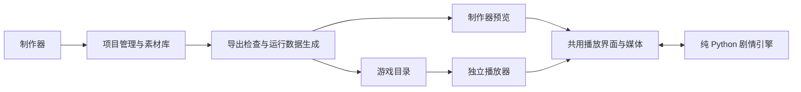

# GalGame Maker 技术架构

本架构覆盖[完整产品需求和首版交付范围](requirements.md)。首版采用 Python 3.13、PySide6 和 PyInstaller，验收平台为 Windows 11 x64。制作器和播放器分别发布，共用剧情引擎。精确字段及运行行为见[首版数据契约](data-contracts.md)，性能目标和可执行用例见[首版架构验收](architecture-verification.md)。

## 完整产品需求基线

本节归档已确认的完整产品范围，随架构文档纳入版本管理。详细条目、字段和测试另在本地文档维护。

- 产品面向不熟悉编程的视觉小说独立开发者。制作器和成品首版使用 Windows，制作、管理、预览、导出和游玩离线可用，AI 功能联网。
- 项目用文件夹保存可编辑数据及复制导入的素材，整体可迁移。制作器另外导出含 exe、运行依赖和资源的游戏目录，玩家可直接启动。
- 统一管理素材、剧本、对白、角色、世界观及音频，支持项目自定义分类与数据库快速索引。条目使用稳定 ID，搜索结果可定位，索引可重建。
- 角色有姓名、介绍、人物关系和可选的整体设定识别图。对白可引用角色，演出立绘单独管理。人物关系默认有向，标签默认 relationship，可改无向且两侧同步。
- 完整立绘管理覆盖每个角色的神态、服装和动作分类，制作时可快捷选择并引用。音频覆盖音乐、音效和角色语音，首版先完成 BGM 和音效。
- 节点可命名、共用和复制，直接按顺序组织对白及演出。剧情图允许汇合、禁止回环。叶节点可以结束故事。分支使用全局及节点局部的 `int`、`bool` 变量与本节点选项判断，支持 `and`、`or`、`not`、`is`、`is not` 和嵌套括号，经过连接时执行预设变量变更。
- 分支可能同时为真时警告并阻止调试和编译导出。非叶节点运行时无法进入后继则报错警告，保留位置和变量。choices 保留最近选择到存档，当前分支逻辑读取当次点击与变量。
- 文本管理允许将节点内已写好的段落主动收录，自动跟随原文更新并保留来源，供人工查找和后续 AI 检索。来源删除后标记失效。
- 成品界面支持自定义，首版换对话框、选项和菜单图片及基础样式。后续自由布局及 Python 界面扩展共用游戏状态和输入操作接口。
- 背景和画布等比适配并填黑边。首版立绘三个槽位，支持缩放。对白每页最多 80 个可见字符，实际容量不足时提前分页，默认每字符 30 毫秒，点击补全本页或推进。
- 存档支持关闭重开后继续，保留文本页位置、变量和选择，避免重复执行连接变更及一次性音效。首版三个手动槽位，片尾和转场中禁用保存，读档后 BGM 从曲首播放。
- 结局支持现成 MP4。后续支持制作人名单、片尾曲、预设或自定义风格生成独立 MP4，能预览并随游戏导出。
- 内置版本管理支持保存、比较和恢复项目及素材历史。后续选定存储方式，恢复通过正常加载与校验流程。
- AI 面向简单重复任务和批处理，使用当前可追溯内容，结果经用户审阅后通过项目编辑入口应用。原文变化及执行失败必须可识别，提供方和首批任务后续确定。

完整产品范围与阶段范围各有记录。尚待设计的是后续能力的具体实现及交互，首版阶段结束后继续按这些条目交付。

## 应用边界

| 模块 | 职责与依赖 |
| --- | --- |
| 剧情引擎 | 纯 Python 模块，定义运行数据、条件求值、变量变更、播放状态和存档快照。输入玩家操作和媒体完成事件，输出界面及播放指令。依赖 Python 标准库。 |
| 项目管理 | 管理可编辑项目、素材、角色、人物关系、设定和文本摘录。提供编辑操作、保存、迁移和查找引用。界面、AI 和将来的版本恢复通过这些操作修改项目。 |
| 制作器 | 提供 PySide6 编辑界面。剧情图和人物关系图复用画布交互，各自使用自己的数据规则。制作器调用项目管理、导出检查和预览。 |
| 播放界面与媒体 | 接收剧情引擎的画面和播放指令，将按键、选项及媒体结束事件转回引擎。预览和成品播放器共用界面组件、主题解析和 Qt Multimedia 实现。 |
| 导出 | 从一个固定的项目快照生成运行数据，检查分支和引用，收集游戏所用资源，并与预打包的播放器组成游戏目录。 |
| 独立播放器 | 打开已导出的游戏，连接剧情引擎、播放界面与存档。发行包的依赖来自播放侧，Z3、制作器组件及联网 AI 属于制作侧。 |

预览调试和导出使用同一套运行数据生成逻辑。预览可读取当前尚未保存的编辑快照，但启动前必须检查完整剧情图的分支条件。发现可能同时为真的分支时，发出警告并阻止调试和编译导出，修改后重新检查。编辑和保存草稿仍可进行。AI、视频生成和后续索引作为制作器中的后台任务运行，界面线程负责接收进度、展示结果并确认项目变更。

完整检查要求当前快照的所有节点均有有效的检查结果。输入未变的结果可以复用，受影响的节点在后台增量重算。

## 数据边界

| 数据 | 建议结构 | 生命周期 |
| --- | --- | --- |
| 可编辑项目 | 项目文件夹中的 `project.json` 和 `assets/`。JSON 保存项目、剧情图、素材目录、设定、关系、摘录和主题。节点坐标等编辑信息独立于剧情语义。 | 随制作项目复制、备份、编辑和迁移。 |
| 导出成品 | 播放器 `.exe` 与运行依赖、`game.json` 和 `assets/`。运行数据包含开始播放所需的节点、连接、变量、发言者显示信息、主题和引用的素材。 | 从项目快照生成。制作器备注、人物关系图、AI 数据和版本历史留在制作项目中。 |
| 玩家存档 | Windows 当前用户的本地应用数据目录，按作品 ID 和存档槽保存。包含版本、当前节点与播放位置、阶段、变量、选择结果及恢复演出所需的状态。 | 随玩家进度更新。游戏导出目录可移动，存档路径不随目录变化。 |
| 派生数据 | 本地搜索索引、缩略图等可重建数据。 | 随项目内容更新，可从项目重新生成。 |

项目、节点、连接、对白及演出条目、选项、变量、角色和素材都使用稳定 ID。名称、排序和磁盘路径是可编辑属性。跨对象引用使用 ID，文件引用使用项目内相对路径。项目 JSON 是编辑内容的权威来源，搜索索引从它派生。

### 项目保存与版本

- 首版保存一个完整的 JSON 快照。通过同目录临时文件写入并替换正式文件，保持旧快照在保存成功前可用。素材先复制到项目内，再提交引用。替换失败时报告原因并保留编辑状态供重试。 [Python 文件替换接口](https://docs.python.org/3.13/library/os.html#os.replace)
- 同一项目的保存操作串行执行。第二个制作器实例打开同一份项目时，以只读方式打开或提示用户使用已有窗口。项目迁移逐版本处理，写入前留一份可恢复的原文件。遇到高于当前制作器支持的项目格式时，提示使用相应版本。
- 创作者引用素材条目，条目指向项目内的文件内容。替换素材时保留条目 ID，生成新的文件内容。将来可以用内容哈希去重并让历史快照引用原文件。历史版本引用的素材保留到相应版本被清理。
- 素材摘要在导入复制期间计算，打开项目时默认信任已保存值。导出把素材复制与重新计算摘要合并为一次流式读取，与快照比对后生成成品标识。主动完整性检查也可后台重新计算。打开性能与素材完整性验证的计时分别统计，具体流程见[素材摘要契约](data-contracts.md#素材摘要的计算和校验时机)。
- 项目格式、运行格式和存档格式各自带版本号。创作项目沿编辑侧迁移规则升级，播放器按运行格式读取数据。成品标识追踪完整导出，存档兼容标识追踪剧情和可恢复状态。只换主题样式或替换同 ID 同类型素材后，旧档仍可用。剧情结构不兼容时保留原存档并说明原因。

### 角色、分类和摘录

- 素材条目保存文件类型、用途分类和标签。角色的整体设定立绘只是可选识别图。游戏立绘作为演出素材单独引用，后续加入按角色、神态、服装和动作查询的立绘变体。语音可沿用素材条目并关联具体对白。
- 人物关系是一条带方向属性的关系记录。无向关系的两个视角引用同一条记录。剧情图禁回环的规则只应用于剧情连接。
- 文本摘录保存来源条目的 ID，显示和检索时读取原文。成员在创建或重新绑定时确定，显示顺序跟随节点。任一来源失效时，整条摘录暂停检索。AI 通过相同的查询接口取得当前文本和来源。

## 剧情执行与分支检查

剧情节点保存一列按顺序播放的对白和演出条目，可有一组选项，以及指向后继节点的连接。连接保存跳转条件与变量变更。布景、立绘、文字和媒体动作使用带类型的演出记录，运行格式可以增加新类型。

1. 引擎从开场节点或存档位置开始。按顺序执行演出指令，在对白与旁白处等待推进。节点末尾如有选项，等待玩家做出一次选择后再检查连接。
2. 每条连接的判断语句读取同一份变更前状态，可以比较 `int`、`bool` 和本次选项 ID，并支持 `and`、`or`、`not`、`is`、`is not` 及嵌套括号。结果为真时该连接命中。仅无选项且只有一条出边的节点允许无条件衔接。非叶节点无匹配时报告错误警告并保留位置和变量，有选项时可重选。`choices` 记录每个节点最近点击的有效选项并随存档保存，当前游戏逻辑直接读取点击事件和变量。
3. 制作器在导出前检查变量类型与运算是否合法。命中唯一连接后，引擎先在临时状态计算该连接的全部变更，再一次提交变量和目标节点位置。读档恢复提交后的状态。遇到非法变更或多个匹配连接时，播放器停止推进，报告异常并保留转场前变量和位置。
4. 显式设置为结局的叶节点完成演出后结束故事。关联了片尾的结局等待视频播放结束，再允许返回标题。未设置结局的叶节点保持停留行为，制作器可以指出该节点供创作者检查。

跳转条件保存为结构化表达式。制作器与播放器使用相同的变量类型、选项取值和比较规则。制作器把同一节点的候选连接条件两两交给 Z3 检查，限制本次选择为该节点合法选项之一。任意一对可以同时为真时，给出节点、冲突连接和示例取值。校验以连接为单位，覆盖两条连接到同一目标却可能执行不同变量变更的情况。首版按合法取值检查，不依赖对历史游玩路径的推断。若检查未能给出结论，明确显示未完成校验并允许重试。发布只接受完成互斥检查的结果。 [Z3 官方指南](https://microsoft.github.io/z3guide/docs/logic/intro/)

### 编辑期间的增量检查

检查结果按源节点缓存，记录状态为待检查、检查中、互斥通过、存在冲突或未完成。键包含检查器语义版本、源节点选项 ID 集合、出边 ID 与目标 ID、每条条件树，以及条件引用的变量 ID 和类型。条件树采用确定性的 JSON 序列化。修改显示名、对白、画布位置、主题和素材不会使分支互斥结果失效。变量初值和连接变更仍需类型检查，其值不影响按合法变量取值进行的互斥证明。

节点内部同时保存每对连接的检查结果，以该对条件、合法选项、所用变量类型和检查器版本作为键。一个节点有部分条件对已完成时，后续批次可从剩余条件对继续，节点全部条件对通过才记为互斥通过。超时或未知结果作为可重试状态，不缓存为通过。

- 编辑条件、增删连接、变更目标或修改选项 ID 集合时，只使该源节点的结果失效。变量删除或改类型使所有引用它的源节点失效，使用反向引用表定位。变量变更列表另按连接检查类型。拓扑改动触发全图无环和引用检查。
- 停止输入 300 毫秒后合并变更，只将受影响节点提交后台求解。每个任务携带检查键，回传时再次对比，过时结果丢弃。当前输入已有结果时直接使用。缓存首版仅在会话内保留，重开项目后后台重新检查。
- 建议预算为每对条件最多 2 秒、一次后台批次累计求解最多 10 秒。超过预算的剩余节点标记待续查，单次超时节点标记未完成。自动后续批次和手动重试都只重算缺失的结果，已完成结果继续复用。这些是首轮实现预算，实测后可调整。
- 调试和导出入口核对整图检查键，复用已通过结果并等待缺失结果。冲突、超时或尚未完成时说明原因和具体节点，允许取消、继续编辑或重试。当前快照全部通过后才启动。每次导出仍对所有运行素材执行摘要比对。

求解时间与界面响应分别验收。编辑、取消检查、切换节点均在界面线程及时响应，求解任务不会阻塞文字输入。

## 预览、导出与存读档

- 制作器先将可编辑快照转换为游戏数据。检查开场、无环、引用、变量及条件类型、主题素材和媒体文件。预览使用选定的开场或节点、测试变量与选项输入。独立播放器使用正式开场及初始值。
- 导出从快照收集运行数据实际引用的素材，在目标旁创建临时目录并验证文件完整性，然后发布成品目录。如需覆盖已有成品，先保留可恢复的旧目录，替换失败时恢复旧成品。播放器相对游戏目录解析路径，导出功能使用随制作器预置的播放器。
- 等待对白推进、等待选项和无匹配停留时可存档。转场和片尾播放期间禁用存档。读档恢复当前位置、变量、画面和等待状态，当前曲目从头继续，已触发的音效和已执行的变量变更不会重放。存档使用临时文件写入后替换，覆盖失败时保留旧存档。
- 播放界面将完整对白或旁白按每页最多 80 个可见字符及对话框实际容量分页，以每字符 30 毫秒逐字显示。引擎保留文本条目和页起点。读档重建当前页并完整显示，文本摘录仍指向完整条目。画面和背景等比适配并填充黑边，立绘按槽位透明叠加。
- Qt 媒体播放通过异步事件告诉引擎何时加载、结束或失败。媒体失败时显示对应素材及错误。发行验收在干净、离线的 Windows 环境检查 Qt 插件和 FFmpeg 库是否齐全。 [Qt Multimedia](https://doc.qt.io/qtforpython-6/PySide6/QtMultimedia/index.html) · [PyInstaller 目录打包](https://pyinstaller.org/en/stable/operating-mode.html)

## 完整需求的扩展路径

| 后续能力 | 扩展位置和复用方式 |
| --- | --- |
| 丰富的素材、文本、设定和角色语音管理 | 在项目数据中扩展内容类型、分类和引用。运行数据只收录有演出需要且播放器支持的内容。分类立绘通过角色和组合标签定位，再把选中的素材 ID 写入演出条目。 |
| 项目数据库快速索引 | 已落地为可重建的本地 SQLite FTS5（`trigram` 分词 + 1–2 字短词子串回退）派生索引（`.cache/search_index.sqlite`），按项目数据版本与实体内容指纹增量更新，损坏或缺失时自动重建。 [SQLite FTS5](https://www.sqlite.org/fts5.html) |
| 内置项目版本管理 | 已在现有保存/加载边界接入 `.versions/` 版本存储（`index.json`、`snapshots/`、`objects/<sha256[:2]>/<sha256>`），支持自动/手动历史快照、按稳定对象 ID 对比差异、基于 SHA-256 去重保留与垃圾清理历史素材，恢复前强制执行格式与素材完整性校验并经正常加载流程恢复。 |
| AI 批处理 | 通过本地查询取得创作者选中的文本和素材元数据，联网任务生成可审阅的修改建议。应用时通过项目编辑操作提交，并检查任务开始后原文是否变化。AI 在制作端独立接入。 |
| 自动生成片尾报幕 | 制作器中的后台任务读取制作人名单、音频和风格，生成独立 MP4。成片按常规流程导入为项目素材，并通过现有结局能力预览和播放。 |
| 自由布局及代码扩展 | 界面先读取版本化的主题配置。后续可增加可视化布局数据。程序员扩展通过明确的 Python 界面接口读取播放状态和提交玩家操作，扩展代码由创作者显式安装并随其作品构建。剧情 JSON 继续通过结构化命令和条件表达行为。 |
| 自动存档、回看和快进 | 自动存档沿用手动存档的快照结构。回看从已播放对白和选择的记录派生。快进通过推进指令和播放策略实现，共用同一剧情状态转换。 |

## 实现顺序与架构验收

1. 先验证打包和媒体链路。用最小 PySide6 播放器生成目录包，在未装 Python 和 Qt 的 Windows 11 x64 环境按[离线媒体与目录打包用例](architecture-verification.md#离线媒体与目录打包)实测。
2. 实现项目读写、稳定 ID、素材复制、剧情引擎和分支检查。用小型数据验证互斥、无匹配停留、共享节点、读档及连接变更只执行一次。验证项目移动后仍可定位素材和来源文本。
3. 接入制作器的节点图、人物关系、素材管理、文本摘录、主题编辑和预览。完成从创建项目到导出的正常入口。验证同一快照与输入在预览和独立播放器中的去向、变量及演出一致。
4. 交付首版示例短篇，按[端到端验收](requirements.md#端到端验收)回归。验证带中文或空格的项目路径、导出失败后重试、保存失败后旧文件仍可用，以及断网状态下的制作、导出和游玩。

当前首版 MVP 及 P2 扩展能力（含依赖版本锁定、媒体探针、PyInstaller 打包脚本、纯 Python 剧情引擎、增量后台 Z3 分支检查、内置项目版本管理、本地 SQLite FTS5 派生搜索索引、PySide6 制作器、独立播放器与示例短篇）已在仓库中落地并通过自动化单元测试；后续工作为干净离线 Windows 环境的真机端到端验收，以及其余进阶能力建设。
